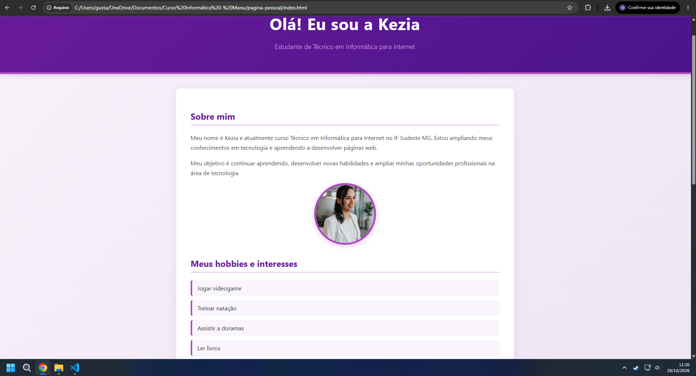

# Atividade - Página Pessoal com CSS

Página pessoal desenvolvida para a disciplina de **Programação Web I** do **IF Sudeste MG - Campus Barbacena**, sob orientação do professor Fábio Ferreira.

## 🎨 Sobre o Projeto
Esta página foi aprimorada utilizando **CSS (Cascading Style Sheets)** externo para estilização, aplicando conceitos de cores, fontes, bordas, dimensões, espaçamentos e organização visual em tons de roxo e lilás.

## 💻 Tecnologias Utilizadas
* HTML5 (Estruturação semântica)
* CSS3 (Folha de estilos externa e design responsivo)

---

## 👩‍💻 Sobre mim
Olá! Meu nome é **Kezia Manuella Alves de Moraes** e esta é minha página pessoal, desenvolvida na disciplina de Programação Web I do curso Técnico em Informática para Internet do IF Sudeste MG.

## 🎮 Meus hobbies
* Jogar videogame
* Treinar natação
* Assistir a doramas
* Ler livros
* Aprender programação e tecnologia

---

## 📩 Entre em contato
A página possui uma seção interativa com um formulário de contato completo contendo os campos **Nome**, **E-mail**, **Assunto** e **Mensagem**, além dos botões **Enviar** e **Limpar**, devidamente estilizados com CSS.

---

## 📸 Pré-visualização e Capturas de Tela

### 1. Visão Geral da Página Pessoal

### 2. Seção do Formulário de Contato

---
Desenvolvido por **Kezia Manuella Alves de Moraes**.
